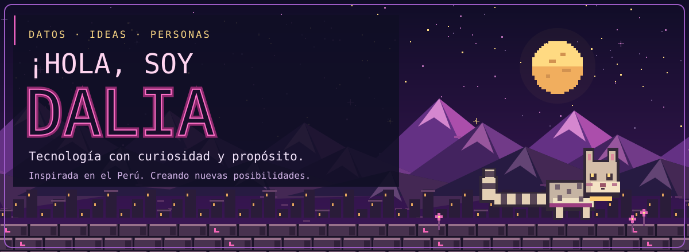
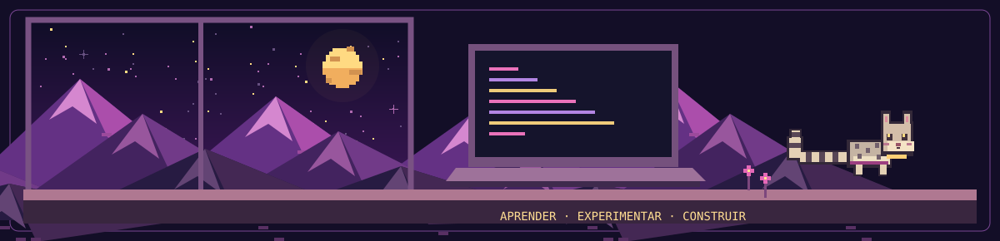
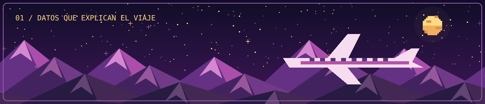
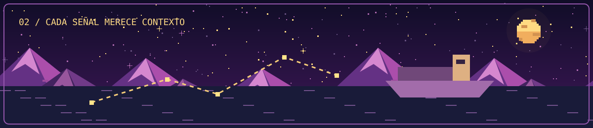
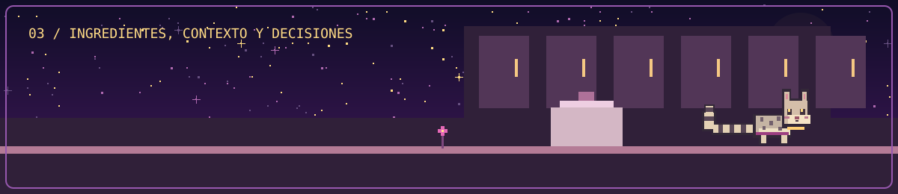
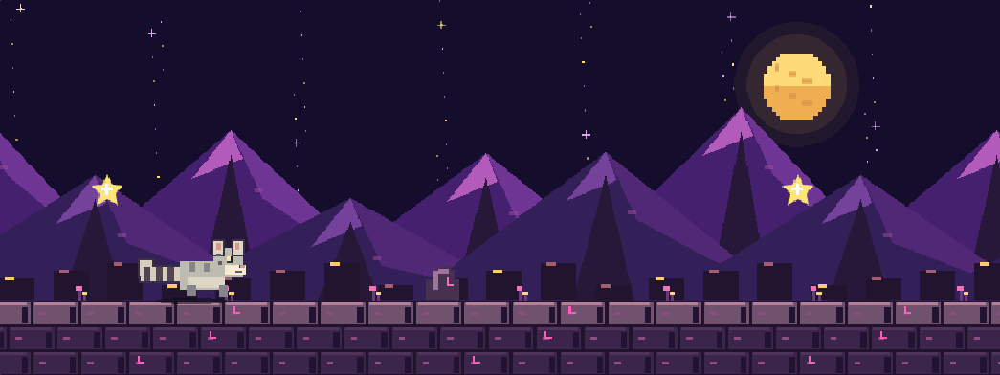

<picture>
  <source media="(max-width: 600px)" srcset="assets/profile/portada-movil.svg">
  
</picture>

# ¡Hola, soy Dalia!

### Estudiante de Ingeniería de Sistemas | Data · IA · Desarrollo y Diseño

Transformo ideas en soluciones digitales, conectando programación, datos y diseño centrado en las personas.

**[Explorar proyectos ↓](#proyectos-destacados)** · **[Jugar con Michi ↗](https://daliazapata.github.io/daliazapata/)** · **[Conectar ↓](#contacto)**

[Sobre mí](#sobre-mí) · [Tecnologías](#tecnologías-y-habilidades) · [Comunidad](#experiencia-y-comunidad) · [Actividad](#actividad-en-github)

## Sobre mí

Soy estudiante de **Ingeniería de Sistemas en la UPC**. Me apasiona transformar ideas en soluciones digitales que combinen programación, análisis de datos, inteligencia artificial y diseño centrado en las personas.

- **Mis intereses:** Data Science, Inteligencia Artificial, agentes de IA, desarrollo Frontend y UX/UI.
- **Actualmente:** amplío mis conocimientos en Backend y exploro nuevas posibilidades de los sistemas agénticos.
- **Mi forma de aprender:** desarrollar proyectos, experimentar y construir experiencias funcionales, intuitivas y visualmente atractivas.

El Perú y su naturaleza inspiran la identidad visual de este espacio. El gato andino me acompaña como símbolo de curiosidad y exploración.

## Tecnologías y habilidades

Tecnologías que pongo en práctica a través de mis proyectos:

**Datos e IA** 
`Python` · `scikit-learn` · `TensorFlow/Keras` · análisis de datos · Machine Learning 
[En FlightPredict →](https://github.com/daliazapata/flightpredict-web)

**Desarrollo Frontend** 
`JavaScript` · `TypeScript` · `React` · `Next.js` 
[En FlightPredict](https://github.com/daliazapata/flightpredict-web) · [En IRIS →](https://github.com/daliazapata/IRIS-Maritime-Intelligence)

**Backend y APIs** 
`Python` · `FastAPI` 
[En FlightPredict](https://github.com/daliazapata/flightpredict-web) · [En IRIS →](https://github.com/daliazapata/IRIS-Maritime-Intelligence)

**Agentes de IA** 
`Gemini` · `Google ADK` · `Pydantic` 
[En Culinary AI Agent →](https://github.com/daliazapata/culinary-ai-agent)

**Herramientas** 
`Git` · `GitHub` · `Vite` · `Tailwind CSS` 
[En FlightPredict](https://github.com/daliazapata/flightpredict-web) · [En IRIS →](https://github.com/daliazapata/IRIS-Maritime-Intelligence)

**En aprendizaje y profundización:** SQL, Backend y sistemas agénticos. **UX/UI** es un área de interés que guía mi exploración del diseño de experiencias.

## Proyectos destacados

### 01 · FlightPredict

> **Datos para comprender los retrasos aéreos.** Aplicación académica que explora retrasos de vuelos domésticos de Estados Unidos y compara enfoques de Machine Learning. Integra una interfaz React con una API FastAPI y modelos Random Forest, K-Means y MLP.

**Python · Machine Learning · FastAPI · React · TypeScript**

Predicciones basadas en datos históricos; no ofrece información operativa de vuelos en tiempo real.

**[Ver repositorio de FlightPredict →](https://github.com/daliazapata/flightpredict-web)**

### 02 · IRIS Maritime Intelligence

> **Cada señal merece contexto.** MVP académico de identificación de anomalías en trayectorias marítimas. Combina cálculos cinemáticos y reglas deterministas para explicar señales de riesgo en dos escenarios sintéticos, con visualización web y mapa.

**Python · FastAPI · Next.js · React · TypeScript · Leaflet**

Proyecto desarrollado en el contexto de WomenCISO4 / MenCISO Gen 1. Utiliza reglas, no modelos de ML; sus señales no demuestran actividades ilícitas ni sustituyen una evaluación profesional.

**[Ver repositorio de IRIS →](https://github.com/daliazapata/IRIS-Maritime-Intelligence)**

### 03 · Culinary AI Agent

> **Ingredientes, contexto y decisiones.** Agente multimodal desarrollado con Gemini y Google ADK para analizar ingredientes y productos, considerar recetas y restricciones declaradas y apoyar decisiones culinarias. Utiliza un subagente y validación estructurada con Pydantic.

**Python · Gemini · Google ADK · Pydantic**

Prototipo de apoyo a la decisión; no certifica la seguridad alimentaria ni sustituye la lectura de etiquetas o el asesoramiento profesional.

**[Ver repositorio de Culinary AI Agent →](https://github.com/daliazapata/culinary-ai-agent)**

*Las ilustraciones de estas tarjetas son originales y conceptuales; no son capturas de las aplicaciones.*

#### También estoy construyendo

**[Rock'em Sock'em Robots →](https://github.com/daliazapata/Rock-em-Sock-em-Robots)**

Exploración de una experiencia web de combate de robots con **Next.js, React y TypeScript**. El repositorio contiene la implementación; su README aún conserva la guía inicial de Next.js.

**[Explorar todos mis repositorios ↗](https://github.com/daliazapata?tab=repositories)**

## Aventura del Gato Andino

### Un pequeño juego, un gran viaje

Acompaña a Michi en una aventura de **30 segundos** entre montañas andinas. Corre automáticamente, recoge estrellas doradas y salta para esquivar las rocas. ¡Intenta superar tu récord personal!

- **En computadora:** salta con **ESPACIO** o **flecha arriba**.
- **En celular:** utiliza el botón **Saltar**.
- **Tu récord:** se guarda en el navegador que utilices para jugar.

### [★ Jugar ahora →](https://daliazapata.github.io/daliazapata/)

**Michi Mini** es el minijuego independiente del perfil. El juego se abre en GitHub Pages; esta imagen es una vista previa estática.

**[Código de la versión mini](mini/)** · **[Repositorio del juego original: Michi Andino](https://github.com/daliazapata/michi-andino)**

## Experiencia y comunidad

### QuantumHub Perú · Voluntariado

Participo como voluntaria en el **área de Innovación**.

### WomenCISO / MenCISO · Formación y proyecto académico

Participo en actividades de la comunidad y en el desarrollo de **IRIS Maritime Intelligence**, un proyecto académico realizado en el contexto de WomenCISO4 / MenCISO Gen 1.

Estos espacios acompañan mi aprendizaje y mi interés por crear tecnología junto a otras personas.

## Actividad en GitHub

Aquí puedes seguir mis proyectos y contribuciones directamente en GitHub:

**[Ver mi actividad y contribuciones →](https://github.com/daliazapata)** · **[Explorar repositorios →](https://github.com/daliazapata?tab=repositories)**

## Contacto

¿Te interesa conversar sobre datos, agentes de IA, desarrollo o proyectos creativos?

- **GitHub:** [@daliazapata](https://github.com/daliazapata)
- **LinkedIn:** pendiente de añadir el enlace confirmado.
- **Correo:** pendiente de añadir una dirección de contacto pública.
- **Portafolio:** pendiente de añadir el enlace confirmado.

<strong>Siempre aprendiendo, siempre explorando.</strong> Desde el Perú, con curiosidad por lo que viene. ✦

